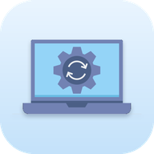

# EPFO Desk – iPhone app + office PC, synced offline



EPFO Desk (formerly Noting Desk) is the offline office tool for **member search across your Excel sheets**, notings, circulars and manuals, office orders, e-mails and replies, the work diary, the IBB calculator, history, sports calendar, Member ID and rejection reasons, and learned templates.

This repository turns it into:

| | What | Where |
|---|---|---|
| 📱 **iPhone app** | Installs from Safari to the Home Screen and then runs **fully offline**. Every module is included, with a phone layout: main tabs (Draft, Members, E-mails, Circulars, Diary), a **More** sheet with all tools, dark mode and share-to-Files. | `docs/index.html`, served by GitHub Pages |
| 🖥️ **Office PC file** | The same `Noting_Desk.html` you use today, plus **👥 Members** and a **🔄 Sync** button. The file name stays the same. | `docs/Noting_Desk.html` (or **Sync ▸ Save Noting_Desk.html** inside the iPhone app) |

The office PC needs **no internet**. Your data never goes to GitHub or any server; it stays in the PC's browser and on the iPhone. GitHub only hosts the app code.

---

## 1. Put the app online (one time, about 2 minutes)

1. On GitHub, open **Settings ▸ General** for this repository and make sure it is **Public**. GitHub Pages is free only for public repositories, and only the app code is in here, never your data.
2. Open **Settings ▸ Pages**. Under **Build and deployment**, set **Source = Deploy from a branch**. Set **Branch = `main`** (or the branch holding this code) and the folder to **`/docs`**, then press **Save**.
3. After about a minute the page shows your link, like `https://<your-user>.github.io/automated-office/`.

## 2. Install on the iPhone

1. Open the link **in Safari**. Other browsers on iPhone cannot install apps.
2. Tap **Share ⬆︎ ▸ Add to Home Screen ▸ Add**.
3. Open **EPFO Desk** from the Home Screen once while you're online. From then on it works with no internet at all.
4. To bring your existing data in, tap **More ▸ 🔄 Sync ▸ Open sync / backup file** and pick a `NotingDesk_backup_*.json` or a sync file from Files or your pen drive.

Updates: when a new version is published, the app shows **"A new version is ready – Update now"** the next time it's opened online.

## 3. Update the office PC

1. In the **old** Noting Desk, make a backup first: **Automate ▸ Backup**.
2. Copy the new `Noting_Desk.html` onto the pen drive. You can get it from the iPhone app (**Sync ▸ Save Noting_Desk.html**) or download `docs/Noting_Desk.html` from this repository.
3. On the PC, replace the old `Noting_Desk.html` with the new one **in the same folder**, and open it in the **same browser** (Chrome or Edge) as before. Your data is kept by the browser, so it is all still there.
4. If anything is missing, use **Automate ▸ Restore** with the backup from step 1. Restoring only adds; it never deletes.

PoHW Desk (`PoHW_Desk.html`) stays as a separate file on the PC. Its cases still travel inside the sync file.

## 4. Members – search your Excel sheets

Open **👥 Members** and type a member number:

| You type | It finds |
|---|---|
| `787` | `APHYD/4566/787`, using the default establishment, which you can change under *Excel files* |
| `4566/787`, `APHYD/4566/787`, `APHYD00045660000000787`, `AP/HYD/0004566/000/0000787` | the same member |
| a UAN or an ACK No | the member it belongs to |
| a name, e.g. `prabhakar` | a list of matching names |

The top card shows the profile: name, both ID formats (tap to copy), UAN, ACK No, PPO, status, demand and DD details. A **⚠ differs** mark appears when two sheets disagree, e.g. a DD amount. Below the card is every matching row from every sheet. Sheets without a member column, such as **UO NOTE**, are linked through the UAN or ACK No.

**Excel stays the master.** The app only reads your files and never changes them.

- **Office PC (automatic):** connect your Noting Desk folder once (top bar **Connect folder**). Then put the `.xlsx` files in the **Excel Data** folder inside it, which is created for you. When you save a change in Excel, EPFO Desk re-reads that file within a minute, and whenever you switch back to it. Removing a file from the folder removes it from the app.
- **PC or iPhone (by hand):** **Members ▸ Excel files ▸ Add / refresh Excel**. Pick the file again after editing it.
- **To the iPhone:** the Excel data travels inside the sync file, the QR sync and the normal backup.

Your Excel files contain member data. Never put them in this GitHub repository; `.gitignore` blocks `*.xlsx`.

## 5. Reading letters and writing notings

**Reader (offline OCR, PC and iPhone).** Phone photos and scans are cleaned up before reading: small photos are upscaled properly, shadows are removed and tilted pages are straightened. Afterwards, PF / UAN / ACK / PPO numbers, dates and amounts are repaired, since letters such as O/0, I/1 and S/5 are confused but EPFO numbers have fixed shapes. Scanned PDF pages are read at about 300 dpi. Digital PDFs keep their own text, now in reading order.

| Tested on blurred, tilted, shadowed phone photos of letters | before | now |
|---|---|---|
| characters read wrong | 38% | 3% |
| PF, UAN, dates, IDs read exactly right | 50% | 86% |
| clean scans | 100% | 100% (unchanged) |

**iPhone photos (HEIC).** iPhones save photos as HEIC, which Chrome and Edge on Windows can't open. Every HEIC photo is now converted to JPEG offline the moment you pick or drop it (libheif, embedded). This works on the PC too, for example for a photo copied over by pen drive.

*Real test:* an employer letter photographed on an iPhone (HEIC, 12 MP), "rectification of erroneous EPS contribution". It was read and drafted in about 10 seconds on the PC as **OB adjustment through Appendix-E – EPS to ER share (member not eligible for EPS)**, with name, UAN, establishment, date of joining and the period February 2018 to August 2018 filled in.

**Choosing the right noting.** The keyword rules are now combined with *"which of your own past notings is this most like"*. This was trained on 159 of your notings across 40 types. Each noting was tested against a model that hadn't seen it:

| | before | now |
|---|---|---|
| right template first time | 51% | 85% |
| right template among the top three | 82% | 94% |
| member's own PF a/c number found | 70% | 88% |

**Filling it.** Several details are now picked up:
- The member's own PF a/c, preferred over transfer-in or previous accounts.
- The name after "in r/o" (including "Late …").
- The establishment and the member's own "from … to …" service.
- The reason for exit and the date of death.
- When the PF a/c or UAN is in your **Members** Excel data, the name, UAN, PPO, ACK No and DD no / date / amount are filled from there.

**It keeps learning.**
- Every noting you save becomes one more example for its type.
- **Learned ▸ 📚 Learn from Word notings** reads a batch of `.docx` files: each noting inside is recognised and remembered.
- These examples travel to the iPhone with the sync file.

The built-in model (`src/addon/nd-model.json`) holds **generic EPFO words only**. A word is kept only if it appears in the public EPFO manuals inside the app, is never part of a person's or company's name, has no digits, and occurs in at least two notings. Your notings themselves are never stored in this repository.

## 6. Sync (both directions, no internet)

Open **🔄 Sync**. On the PC it's in the left bar; on the iPhone it's under **More**.

### Pen-drive sync file: everything at once
| Step | Office PC | iPhone |
|---|---|---|
| PC ➜ iPhone | **Create sync file** and save it on the OTG pen drive | Plug in the pen drive ▸ **Open sync / backup file** ▸ pick the file |
| iPhone ➜ PC | **Open sync / backup file** ▸ pick the file from the pen drive | **Create sync file** ▸ **Save to Files** ▸ choose the pen drive |

- Tick **Include the PDFs and attachments** when you want the PDFs too. The file gets bigger.
- Merging never overwrites. New items are added, and when both devices changed the same item **the newer edit wins**. Items deleted on one device stay deleted.
- Old backup files (`NotingDesk_backup_*.json`) open the same way.

### QR quick sync: a few new entries, no cable
1. On the sending device choose what to send, such as *changes since last send* or *last 24 hours*, and tap **Show QR codes**.
2. On the receiving device tap **Scan QR codes** and hold the camera on the screen. The codes loop until every piece is caught, in any order.
3. When done, tap **Received on the other device** on the sender, so the next send only carries newer changes.

- PC ➜ iPhone works with the iPhone camera.
- iPhone ➜ PC needs a webcam on the PC. Without one, use the pen-drive file.
- PDFs are never sent by QR. For large amounts (more than about 100 codes) the pen-drive file is quicker.

---

## For developers

```
src/Noting_Desk_base.html   original Noting Desk (unchanged)
src/addon/nd-members.js     Members tab: Excel import, member-ID matching, profile, Excel Data folder watch
src/addon/nd-reader.js      offline reader: image clean-up, deskew, EPFO number repair, PDF reading order
src/addon/nd-heic.js        iPhone HEIC photos → JPEG (offline, libheif 1.19.8 LGPL-3.0 in src/vendor)
src/addon/nd-learn.js       template choice from your notings, PF/name/service extraction, Excel fill, learning
src/addon/nd-model.json     the learned model (generic EPFO words only; built by tools/build_model.py)
src/addon/nd-sync.js        Sync panel: pen-drive file + QR send/scan (uses ndPack/ndMerge/ndRestore)
src/addon/nd-pwa.js         iPhone layer: service worker, share-sheet saving, More sheet, install hint
src/addon/nd-mobile.css     premium phone layout (safe areas, frosted bars, 16px inputs on iOS)
src/vendor/                 qrcode-generator 1.4.4 (MIT), jsQR 1.4.0 (Apache-2.0) – embedded for offline use
src/sw.template.js          offline cache (version stamped per build)
src/brand/logo_source.png   the EPFO Desk logo
tools/make_icons.py         makes the app icons from the logo
build.py                    builds docs/ (index.html, Noting_Desk.html, sw.js, manifest)
```

Build after any change, then commit `docs/`:

```bash
python3 build.py
```

To update the base app, replace `src/Noting_Desk_base.html` with the newer PC file and rebuild. The add-ons are injected before `</body>` and don't modify the original code.

The sync file uses the same format as the app's own full backup (`app: "NotingDesk", v: 4`) plus a `sync` block, so any Noting Desk version that can restore a backup can read it.
